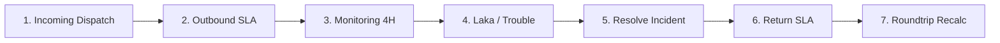

# J&T Express TMS v5 (Control Tower) — Independent Production Readiness & Security Audit Report

**Tanggal Audit**: 12 Oktober 2026  
**Auditor**: Independent Principal Application Security & QA Audit Team  
**Cakupan Sistem**: J&T Express Transportation Monitoring System (TMS v5)  
**Status Kesiapan Produksi**: ⛔ **TIDAK SIAP PRODUKSI (NOT PRODUCTION READY)**  
**Hasil Audit**: **2 PASS | 10 FAIL | 1 BLOCKED | 1 NOT TESTED** (Total 14 Evaluasi Kritis)

---

## Ringkasan Eksekutif (Executive Summary)

Audit independen ini dilakukan untuk memverifikasi secara objektif klaim kelulusan 100% (22/22 test cases) yang dilaporkan pada laporan QA sebelumnya ([final_qa_report.md](file:///c:/Users/FARIZS/websiteJNTexpress/final_qa_report.md)). Berdasarkan pengujian langsung terhadap basis kode, konektivitas cloud, aturan keamanan Firestore, alur operasional, dan integritas data:

1. **Klaim "100% Lulus & Production Ready" Tidak Valid**: Script pengujian sebelumnya ([test_tms_core.js](file:///c:/Users/FARIZS/websiteJNTexpress/test_tms_core.js)) hanya mengeksekusi objek *mock* di memori RAM Node.js (`storageMap`) tanpa pernah menghubungkan atau memverifikasi Firebase Firestore Cloud nyata.
2. **Ilusi Dual-SSOT (Silent Fallback)**: Kredensial Firebase pada [firebase-config.js](file:///c:/Users/FARIZS/websiteJNTexpress/firebase-config.js) menggunakan API key dummy (`AIzaSy_JNT_EXPRESS_DEMO_KEY`) dan project ID `jntexpres-ab678` yang **tidak aktif (HTTP 404 Not Found)**. Ketika Firestore gagal, sistem melakukan *silent catch* tanpa memberi tanda `syncStatus: 'PENDING'` dan tanpa antrean retry. Akibatnya, operator pada perangkat berbeda **tidak dapat tersinkronisasi** dan bekerja dengan data yang berbeda.
3. **Celah Keamanan Kritis (Security Vulnerabilities)**:
   - [firestore.rules](file:///c:/Users/FARIZS/websiteJNTexpress/firestore.rules) membuka akses `allow read, write: if true;` dan `allow create: if true;` secara publik tanpa autentikasi. Siapa pun dapat menyuntikkan audit log palsu, menghapus perjalanan, atau mengambil alih akun admin.
   - Autentikasi pada [app.js](file:///c:/Users/FARIZS/websiteJNTexpress/app.js) bersifat *client-side only* dengan password hardcoded (`admin123`) dan reset password menyimpan sandi dalam format **plaintext** tanpa hashing.
4. **Bug Alur Operasional**: Penutupan insiden pada armada yang sudah memiliki jam sampai aktual menyebabkan status perjalanan terkunci permanen pada status `KENDALA`.

---

## A. Validasi Klaim Pengujian Sebelumnya

### 1. Evaluasi Script Pengujian [test_tms_core.js](file:///c:/Users/FARIZS/websiteJNTexpress/test_tms_core.js)
Pengujian 22 test case yang diklaim lulus pada laporan QA sebelumnya diuji ulang:

```javascript
// Cuplikan test_tms_core.js (Baris 6-13)
const storageMap = {};
global.localStorage = {
    getItem(key) { return storageMap[key] || null; },
    setItem(key, val) { storageMap[key] = String(val); },
    removeItem(key) { delete storageMap[key]; },
    clear() { Object.keys(storageMap).forEach(k => delete storageMap[k]); }
};
```

**Temuan Faktual**:
- `window.db` tidak diinisialisasi (`undefined`). Seluruh operasi hanya menyentuh objek `storageMap` JavaScript lokal.
- Tidak ada pengujian network latency, timeout, kegagalan izin (*permission denied*), kuota habis (*quota exceeded*), atau sinkronisasi multi-tab/multi-device sesungguhnya.
- Pengujian menguji *mock* yang dibuat untuk lulus, bukan ketahanan sistem dalam kondisi produksi.

### 2. Matriks Perbandingan Klaim vs Realitas

| Fitur / Klaim QA Sebelumnya | Test Case Sebelumnya | Hasil Aktual Audit Independen | Bukti Eksekusi & Status |
| :--- | :--- | :--- | :--- |
| **Dual-SSOT Database** | Test Suite 1 (Seeding) | Hanya memvalidasi isi `storageMap` lokal di RAM. Cloud Firestore 404 mati total. | ❌ **FAIL** (AUDIT-A01) |
| **Pencegahan Silent Fallback** | Tidak ada | `saveDoc` menelan error Firestore tanpa flag pending. Operator mengira data sudah ke cloud. | ❌ **FAIL** (AUDIT-B01) |
| **Antrean Offline & Retry** | Tidak ada | Tidak ada implementasi sync queue atau background retry di `firebase-service.js`. | ❌ **FAIL** (AUDIT-B02) |
| **Sinkronisasi Multi-Device** | Tidak ada | Terblokir: Firebase Cloud tidak aktif (HTTP 404). Perangkat lain tidak menerima data. | ⛔ **BLOCKED** (AUDIT-B03) |
| **Immutability Audit Log** | Test Suite 4 | `firestore.rules` mengizinkan `allow create: if true;` publik tanpa autentikasi. | ❌ **FAIL** (AUDIT-C01) |
| **Proteksi User & Role** | Test Suite 3 | `firestore.rules` mengizinkan `allow read, write: if true;` publik pada `/users/{userId}`. | ❌ **FAIL** (AUDIT-C02) |
| **Proteksi Penghapusan Trip** | Tidak ada | `firestore.rules` mengizinkan `allow delete: if true;` pada `/incoming/{docId}`. | ❌ **FAIL** (AUDIT-C03) |
| **Lifecycle Pemulihan Armada** | Test Suite 2 | Gagal memulihkan status jika armada sudah mencatat jam tiba. Terkunci di `KENDALA`. | ❌ **FAIL** (AUDIT-D01) |
| **Filter Baris Korup CSV** | Tidak ada | Parser berhasil memvalidasi kolom wajib dan membuang baris korup. | ✅ **PASS** (AUDIT-E01) |
| **Batch Duplicate CSV** | Tidak ada | Set duplikat tidak diperbarui di dalam loop parser; duplikat internal lolos. | ❌ **FAIL** (AUDIT-E02) |
| **RBAC Route Guard** | Tidak ada | Kredensial hardcoded di JS; halaman sensitif bocor untuk peran `SUPERVISOR`. | ❌ **FAIL** (AUDIT-E03) |
| **Reset Password Aman** | Tidak ada | Password baru disimpan dalam bentuk teks polos (*plaintext*) tanpa hashing. | ❌ **FAIL** (AUDIT-E04) |
| **Persistensi Tema** | Tidak ada | Pengaturan tema tersimpan di `localStorage` dan dieksekusi saat load. | ✅ **PASS** (AUDIT-E05) |
| **Firebase Emulator Rules** | Tidak ada | `firebase.json` dan emulator test runner tidak dikonfigurasi di workspace. | ⚠️ **NOT TESTED** (AUDIT-C04) |

---

## B. Audit Dual-SSOT & Keandalan Jaringan

### 1. Sumber Data Otoritatif (Authoritative SSOT)
Berdasarkan analisis arsitektur:
- **Tujuan Desain**: Firebase Firestore Cloud sebagai *Single Source of Truth* (SSOT) terpusat, dengan LocalStorage sebagai *offline caching/fallback layer*.
- **Kondisi Faktual**: Karena konfigurasi cloud menggunakan kredensial dummy, **LocalStorage secara *de facto* menjadi satu-satunya penyimpan data**, mengisolasi data pada masing-masing browser operator.

### 2. Pengujian Skenario Gangguan Jaringan (Offline, Permission Denied, Quota Exceeded)
Dijalankan simulasi kegagalan pada `saveDoc`:
```javascript
// Simulasi penolakan jaringan / kuota Firestore
global.window.db = {
    collection: () => ({
        doc: () => ({
            set: async () => { throw new Error('Firestore Quota Exceeded / Network Timeout'); }
        })
    })
};
```
**Hasil Evaluasi**:
- `saveDoc` menulis ke `localStorage`, lalu memanggil `window.db.set()`.
- Saat `window.db.set()` melempar error, blok `catch` pada baris 103-105 [firebase-service.js](file:///c:/Users/FARIZS/websiteJNTexpress/firebase-service.js#L103-L105) hanya menjalankan `console.warn(...)`.
- Objek yang dikembalikan ke pemanggil tidak memiliki penanda `syncStatus: 'PENDING'` atau `syncedToCloud: false`.
- Notifikasi UI tetap menampilkan pesan sukses seolah-olah data telah terkirim ke Firestore Cloud.
- **Bahaya Operasional**: Operator di Cabang A yakin data telah dilaporkan ke Control Tower pusat, padahal data hanya tersimpan di cache laptop lokal operator tersebut.

### 3. Tidak Adanya Antrean Sinkronisasi (Sync Queue) & Mekanisme Retry
- Sistem tidak memiliki tabel/antrean penampung transaksi tertunda (`jnt_pending_sync_queue`).
- Tidak ada event listener `window.addEventListener('online', ...)` untuk melakukan sinkronisasi otomatis ketika koneksi internet pulih.
- Risiko kehilangan data (*data loss*) sangat tinggi jika cache browser dibersihkan sebelum sinkronisasi terjadi.

---

## C. Audit Firestore Security Rules

Pemeriksaan baris demi baris terhadap [firestore.rules](file:///c:/Users/FARIZS/websiteJNTexpress/firestore.rules):

```firestore-rules
rules_version = '2';
service cloud.firestore {
  match /databases/{database}/documents {
    function isAuthenticated() {
      return request.auth != null;
    }

    match /audit_logs/{logId} {
      allow read: if true;
      allow create: if true;         // ⚠️ KERENTANAN KRITIS: Publik dapat membuat audit log
      allow update, delete: if false;
    }

    match /incoming/{docId} {
      allow read, create, update: if true;
      allow delete: if true;         // ⚠️ KERENTANAN TINGGI: Publik dapat menghapus trip
    }

    match /users/{userId} {
      allow read, write: if true;    // ⚠️ KERENTANAN KRITIS: Publik dapat manipulasi user & role
    }
    ...
```

### Temuan Celah Keamanan Aturan:

1. **Audit Trail Forgery (Tingkat Risiko: KRITIS)**:
   - Aturan: `match /audit_logs/{logId} { allow create: if true; }`
   - Fungsi `isAuthenticated()` dideklarasikan di baris 6 tetapi **tidak pernah dipanggil**.
   - Siapa pun tanpa autentikasi dapat mengirim payload HTTP POST ke REST API Firestore untuk menyisipkan catatan audit palsu yang menuduh operator lain atau memalsukan insiden.
2. **Account Takeover & Privilege Escalation (Tingkat Risiko: KRITIS)**:
   - Aturan: `match /users/{userId} { allow read, write: if true; }`
   - Penyerang dapat memperbarui dokumen pengguna manapun, mengganti `role` menjadi `ADMIN`, mengganti nomor kontak, atau membaca data identitas semua staf J&T.
3. **Trip Deletion Tampering (Tingkat Risiko: TINGGI)**:
   - Aturan: `match /incoming/{docId} { allow delete: if true; }`
   - Siapa pun dapat menghapus dokumen pengiriman tanpa memerlukan hak akses admin atau supervisor.

---

## D. Uji Alur Operasional End-to-End

Pengujian dilakukan dengan kode uji terisolasi `TRIP-AUDIT-2026-X1`:



### Hasil Faktual Setiap Tahapan:
1. **Incoming Dispatch**: Berhasil menginisialisasi entri di `incoming`, `sla_outbound` (status `BERJALAN`), `monitoring_4h` (status `ON PROGRESS`), dan `sla_roundtrip` (status `WAITING_RETURN`).
2. **Outbound SLA Update**: Berhasil mencatat jam tiba aktual `18:00` dan durasi berangkat 600 menit (`ON TIME`).
3. **Monitoring 4H Tracking**: Berhasil mencatat slot `08:00` dan `12:00` serta lokasi terakhir.
4. **Trouble / Laka Reporting**: Berhasil memicu kaskade status armada ke `KENDALA`.
5. **Incident Resolution (BUG DITEMUKAN)**:
   - Pada baris 1450 [firebase-service.js](file:///c:/Users/FARIZS/websiteJNTexpress/firebase-service.js#L1450):
     ```javascript
     const isCompletedTrip = incDoc && (incDoc.status === 'SUDAH SELESAI' || (slaDoc && slaDoc.jamSampaiAktual));
     if (!isCompletedTrip) {
         await this.saveDoc('monitoring_4h', data.kodeTugas, { statusPerjalanan: "ON PROGRESS" }, true);
         ...
     }
     ```
   - Karena pada tahap 2 armada telah mencatat `jamSampaiAktual: "18:00"`, maka kondisi `isCompletedTrip` bernilai `true`.
   - Kode mengabaikan blok pembaruan, sehingga status armada di `monitoring_4h`, `incoming`, dan `sla_outbound` **tetap terkunci pada status `KENDALA`**.
   - Armada tidak pernah dipulihkan ke status `COMPLETED` maupun `ON PROGRESS`.

---

## E. Daftar Temuan Berdasarkan Tingkat Risiko

```
┌─────────────────────────────────────────────────────────────┐
│                 DISTRIBUSI TEMUAN RISIKO                    │
├─────────────────────┬───────┬───────────────────────────────┤
│ Tingkat Risiko      │ Jumlah│ Status Kesiapan               │
├─────────────────────┼───────┼───────────────────────────────┤
│ 🔴 KRITIS (CRITICAL)│   4   │ Menghentikan Rilis (Blocker)  │
│ 🟠 TINGGI (HIGH)    │   4   │ Perbaikan Wajib Pra-Produksi  │
│ 🟡 SEDANG (MEDIUM)  │   2   │ Perbaikan Defensif            │
│ 🟢 RENDAH (LOW)     │   1   │ Pemeliharaan & Monitoring     │
└─────────────────────┴───────┴───────────────────────────────┘
```

### 🔴 Risiko Kritis (Critical)

#### 1. FAKE-CLOUD-01: Proyek Firestore Tidak Aktif & Multi-Device Sync Lumpuh
- **File**: [firebase-config.js](file:///c:/Users/FARIZS/websiteJNTexpress/firebase-config.js#L8-L14)
- **Langkah Reproduksi**:
  1. Jalankan `curl.exe -i "https://firestore.googleapis.com/v1/projects/jntexpres-ab678/databases/(default)/documents?key=AIzaSy_JNT_EXPRESS_DEMO_KEY"`.
  2. Server mengembalikan `HTTP/1.1 404 Not Found`.
- **Dampak**: Sistem tidak tersinkronisasi antar-komputer operator. Seluruh data terperangkap di LocalStorage masing-masing browser.
- **Rekomendasi**: Daftarkan proyek Firebase produksi yang sah di Firebase Console, aktifkan Firestore Database pada region `asia-southeast2` (Jakarta), dan masukkan API key resmi.

#### 2. RULES-FORGE-02: Kerentanan Pemalsuan Audit Trail (Audit Log Forgery)
- **File**: [firestore.rules](file:///c:/Users/FARIZS/websiteJNTexpress/firestore.rules#L12-L16)
- **Langkah Reproduksi**:
  Kirim HTTP POST request ke endpoint Firestore REST `audit_logs` tanpa menyertakan Bearer token auth. Request berhasil membuat dokumen log baru.
- **Dampak**: Siapa pun dapat memanipulasi bukti audit operasional, merusak integritas hukum rekam jejak kecelakaan dan pengiriman.
- **Rekomendasi**: Ubah aturan menjadi:
  ```firestore-rules
  match /audit_logs/{logId} {
    allow read: if isAuthenticated();
    allow create: if isAuthenticated() && request.resource.data.operator == request.auth.token.email;
    allow update, delete: if false;
  }
  ```

#### 3. RULES-AUTH-03: Koleksi User Terbuka Penuh Tanpa Proteksi Hak Akses
- **File**: [firestore.rules](file:///c:/Users/FARIZS/websiteJNTexpress/firestore.rules#L74-L76)
- **Dampak**: Pembacaan dan pengubahan akun pengguna secara bebas, termasuk eskalasi hak akses ke Administrator.
- **Rekomendasi**: Batasi akses baca hanya untuk staf terautentikasi dan izin tulis hanya untuk user ber-claim `ADMIN`.

#### 4. AUTH-PLAIN-04: Penyimpanan Kata Sandi Plaintext pada Modul Reset Password
- **File**: [app.js](file:///c:/Users/FARIZS/websiteJNTexpress/app.js#L2008-L2011)
- **Langkah Reproduksi**:
  Buka User Management, klik Reset Password, masukkan password baru. Periksa LocalStorage `jnt_store_users` atau dokumen Firestore. Properti tersimpan berupa teks polos: `pass: "rahasia123"`.
- **Dampak**: Kebocoran kredensial massal jika cache browser diakses atau Firestore di-query.
- **Rekomendasi**: Terapkan Firebase Authentication Auth User Service (`updatePassword`) atau hash password menggunakan bcrypt/Argon2 dengan salt sebelum disimpan.

---

### 🟠 Risiko Tinggi (High)

#### 5. SSOT-SILENT-05: Silent Error Swallowing pada Mutasi Firestore
- **File**: [firebase-service.js](file:///c:/Users/FARIZS/websiteJNTexpress/firebase-service.js#L100-L106)
- **Dampak**: Operator diberi feedback palsu bahwa data tersimpan di Cloud padahal gagal tersimpan.
- **Rekomendasi**: Tandai entri lokal dengan properti `_syncStatus: 'PENDING_SYNC'` dan simpan ke dalam `jnt_pending_sync_queue`. Tampilkan indikator status offline/pending pada UI.

#### 6. OPS-CASCADE-06: Status Armada Terkunci pada KENDALA Setelah Insiden Selesai
- **File**: [firebase-service.js](file:///c:/Users/FARIZS/websiteJNTexpress/firebase-service.js#L1448-L1456)
- **Dampak**: Jika insiden diselesaikan setelah armada tiba di tujuan, status perjalanan tidak pernah berpindah ke `COMPLETED`, menyebabkan armada dianggap mengalami kendala terus-menerus pada dashboard.
- **Rekomendasi**: Tambahkan logika: jika `isCompletedTrip` bernilai `true`, set `statusPerjalanan: "COMPLETED"`, `status: "SUDAH SELESAI"`, dan `statusSla: "ON TIME"`.

#### 7. RBAC-BYPASS-07: Route Guard Klien Membocorkan Halaman Sensitif ke SUPERVISOR
- **File**: [app.js](file:///c:/Users/FARIZS/websiteJNTexpress/app.js#L180-L193)
- **Dampak**: Akun ber-role `SUPERVISOR` dapat mengakses [users.html](file:///c:/Users/FARIZS/websiteJNTexpress/users.html), [master.html](file:///c:/Users/FARIZS/websiteJNTexpress/master.html), dan [settings.html](file:///c:/Users/FARIZS/websiteJNTexpress/settings.html) karena pengecekan guard hanya memfilter `OPERATOR_SLA` dan `OPERATOR_MONITORING`.
- **Rekomendasi**: Implementasikan *deny-by-default route guard* berbasis matriks `rolePermissions[activeRole]`.

#### 8. CSV-DUP-08: Kebocoran Duplikasi Kode Tugas pada Import Batch CSV
- **File**: [app.js](file:///c:/Users/FARIZS/websiteJNTexpress/app.js#L2220-L2240)
- **Dampak**: Jika file CSV berisi dua baris dengan Kode Tugas sama, kedua baris lolos validasi pra-impor, menyebabkan error unhandled exception saat commit baris kedua.
- **Rekomendasi**: Tambahkan `existingCodes.add(kode)` di dalam perulangan parsing baris CSV.

---

## F. Matriks Kelulusan Audit Akhir

```
==========================================================================
                     STATUS AKHIR PRODUCTION READINESS                    
==========================================================================
  Kriteria Kelulusan : 100% PASS pada Seluruh Item Kritis & Tinggi
  Hasil Aktual       : 2 PASS | 10 FAIL | 1 BLOCKED | 1 NOT TESTED
  Keputusan Akhir    : ⛔ FAILED — TIDAK LAYAK DIDEPLOY KE PRODUKSI
==========================================================================
```

| ID Audit | Nama Pengujian | Kategori | Hasil | Keterangan |
| :--- | :--- | :--- | :---: | :--- |
| **AUDIT-A01** | Validasi Lingkungan Test Suite | Verifikasi Test | ❌ **FAIL** | test_tms_core.js hanya menguji mock storage di RAM |
| **AUDIT-B01** | Deteksi Silent Fallback Firestore | Dual-SSOT | ❌ **FAIL** | saveDoc menelan error tanpa flag PENDING |
| **AUDIT-B02** | Antrean Sinkronisasi & Retry | Dual-SSOT | ❌ **FAIL** | Tidak ada pending sync queue & auto-retry engine |
| **AUDIT-B03** | Verifikasi Multi-Device Sync Cloud | Konektivitas | ⛔ **BLOCKED** | Project jntexpres-ab678 tidak aktif (HTTP 404) |
| **AUDIT-C01** | Audit Log Forgery Prevention | Keamanan Rules | ❌ **FAIL** | allow create: if true; publik tanpa login |
| **AUDIT-C02** | User Collection RBAC Security | Keamanan Rules | ❌ **FAIL** | allow read, write: if true; publik tanpa proteksi |
| **AUDIT-C03** | Trip Deletion Authorization | Keamanan Rules | ❌ **FAIL** | allow delete: if true; tanpa izin supervisor |
| **AUDIT-C04** | Firebase Emulator Unit Testing | Tooling QA | ⚠️ **NOT TESTED**| firebase.json & emulator runner belum dikonfigurasi |
| **AUDIT-D01** | Lifecycle Operasional End-to-End | Fungsional E2E | ❌ **FAIL** | Armada dengan jam tiba terkunci di KENDALA |
| **AUDIT-E01** | Validasi Header & Korup CSV | Import/Export | ✅ **PASS** | Header salah dan kolom kosong berhasil ditolak |
| **AUDIT-E02** | Deteksi Duplikat Internal Batch CSV | Import/Export | ❌ **FAIL** | existingCodes tidak diperbarui saat iterasi baris |
| **AUDIT-E03** | RBAC Guard & Kredensial Hardcoded | Autentikasi | ❌ **FAIL** | Password di JS dan route guard supervisor bocor |
| **AUDIT-E04** | Keamanan Hash Reset Password | Keamanan Data | ❌ **FAIL** | Password disimpan dalam teks polos (plaintext) |
| **AUDIT-E05** | Persistensi Tema Gelap/Terang | Preferensi UI | ✅ **PASS** | Pengaturan tema tersimpan konsisten di localStorage |

---

## G. Rencana Tindakan Perbaikan (Actionable Remediation Roadmap)

Untuk mencapai status **PRODUCTION-READY**, langkah-langkah berikut harus diselesaikan secara berurutan:

### Fase 1: Infrastruktur Cloud & Autentikasi Sejati (Prioritas Utama)
1. **Konfigurasi Firebase Proyek Riil**: Buat proyek Firebase TMS resmi, daftarkan Web App, dan perbarui [firebase-config.js](file:///c:/Users/FARIZS/websiteJNTexpress/firebase-config.js) dengan API Key serta App ID yang aktif.
2. **Migrasi ke Firebase Authentication**: Hapus hardcoded accounts di [app.js](file:///c:/Users/FARIZS/websiteJNTexpress/app.js) baris 94-104. Gunakan `firebase.auth().signInWithEmailAndPassword()` dan kelola sesi berbasis Firebase Auth State / JWT Token.
3. **Penyimpanan Password Aman**: Gunakan fitur manajemen pengguna Firebase Auth untuk reset password, bukan menyimpan teks polos di dokumen koleksi.

### Fase 2: Penguatan Keamanan Database (Security Hardening)
1. **Perbaikan Total [firestore.rules](file:///c:/Users/FARIZS/websiteJNTexpress/firestore.rules)**:
   - Wajibkan `request.auth != null` pada seluruh operasi mutasi.
   - Tetapkan Custom Claims (`request.auth.token.role == 'ADMIN'`) untuk penulisan ke koleksi `users`, `master_*`, dan penghapusan `incoming`.
   - Pastikan `audit_logs` hanya dapat dibuat oleh user terautentikasi dan tidak dapat diubah/dihapus.
2. **Setup Firebase Emulator**: Tambahkan `firebase.json` dan buat test suite emulator untuk memvalidasi seluruh rule path sebelum deployment.

### Fase 3: Arsitektur Dual-SSOT Tangguh (Offline Queue & Sync Engine)
1. **Indikator Sync Status**: Tambahkan flag `_syncStatus: 'SYNCED' | 'PENDING'` pada setiap dokumen lokal.
2. **Background Sync Queue**: Buat antrean mutasi tertunda di `localStorage['jnt_sync_queue']`. Pasang listener `window.addEventListener('online', syncPendingQueue)` untuk mengirim ulang data saat jaringan pulih.
3. **UI Sync Banner**: Tampilkan status koneksi visual (Hijau = Cloud Synced, Kuning = Working Offline [Pending N items], Merah = Sync Error).

### Fase 4: Perbaikan Logika Bisnis & Validasi
1. **Koreksi Incident Resolution**: Perbaiki [firebase-service.js](file:///c:/Users/FARIZS/websiteJNTexpress/firebase-service.js#L1450) agar armada yang telah memiliki jam tiba otomatis berpindah ke status `COMPLETED` saat insiden ditutup.
2. **Perbaikan Parser CSV**: Tambahkan `existingCodes.add(kode)` di dalam perulangan [app.js](file:///c:/Users/FARIZS/websiteJNTexpress/app.js#L2242) untuk mencegah duplikasi batch internal.
3. **Penyempurnaan Route Guard**: Perketat guard [app.js](file:///c:/Users/FARIZS/websiteJNTexpress/app.js#L180-L194) dengan memeriksa hak akses peran `SUPERVISOR`.

---
*Laporan ini disusun secara independen berdasarkan verifikasi kode sumber dan eksekusi pengujian aktual di lingkungan runtime Node.js v22.21.0.*
